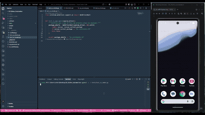
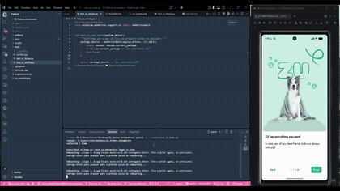

# ZU Android UI Automation

Android UI automation for the ZU app using **Python, Appium, and pytest**. The suite verifies that the app opens and advances through onboarding to its final screen. Each Appium session can also save a screen recording and screenshot to support failure analysis.


## Why this project

This project demonstrates an end-to-end mobile QA workflow: starting an Appium session, synchronizing with the live interface, checking a critical user journey, and preserving evidence that makes each run easier to review. It also explores how to present that evidence in a compact, reproducible portfolio project.

## Test coverage

| Test | What it checks |
| --- | --- |
| `test_zu_app_opens` | The ZU app is in the foreground on the emulator. |
| `test_zu_onboarding_reaches_final_step` | The final onboarding screen shows an enabled **Enter** button and no **Next** button. |

The onboarding test stops on the final onboarding screen. It does not tap **Enter** or verify the home screen. The flow runs without pauses by default. For a guided demo, enable interactive mode to pause at each onboarding step and at the final screen. The automated flow can run in CI when an emulator, Appium, and the app are available.

## Demo recordings

These previews were created from Appium session recordings:

| App launch | Onboarding | Final onboarding steps |
| --- | --- | --- |
|  |  |  |

## Requirements

- Windows, Python, and PowerShell.
- Node.js, the Appium Server, and the UiAutomator2 driver.
- Android SDK Platform Tools (`adb`) and a running Android emulator.
- The ZU app installed on the emulator with package name `pt.continente.ZU`.
- FFmpeg on `PATH` to generate the demo GIF. MP4 recordings are saved without FFmpeg.

The default capabilities use device `emulator-5554` and Appium server `http://127.0.0.1:4723`. Override these settings with `ZU_DEVICE_NAME`, `ZU_APP_PACKAGE`, `ZU_APP_ACTIVITY`, and `ZU_APPIUM_URL`.

## Setup and run

From the project directory, create and activate a virtual environment, then install the Python dependencies:

```powershell
py -m venv .venv
.\.venv\Scripts\Activate.ps1
python -m pip install -r requirements.txt
```

Install the UiAutomator2 driver once if it is not already installed:

```powershell
appium driver install uiautomator2
```

Start the emulator and confirm that ADB can see it:

```powershell
adb devices
```

Start Appium in a PowerShell window and leave it running:

```powershell
appium --address 127.0.0.1 --port 4723
```

In a second window, run the tests. By default, onboarding proceeds without manual input:

```powershell
pytest -v
```

To pause at each step and inspect the screens, enable interactive mode. The `-s` option lets pytest pass Enter prompts through to the terminal:

```powershell
pytest -s -v --interactive-onboarding
```

To use a different emulator or Appium endpoint in PowerShell:

```powershell
$env:ZU_DEVICE_NAME = "emulator-5556"
$env:ZU_APPIUM_URL = "http://127.0.0.1:4725"
pytest -v
```

Run only the app launch test:

```powershell
pytest -v tests/test_zu_smoke.py
```

Skip screen recording:

```powershell
pytest -v --no-record-video tests/test_zu_smoke.py
```

## Test artifacts

The `appium_driver` fixture starts one Appium session per test and attempts to save:

- An MP4 recording in `artifacts/videos/` (Android screen recording is limited to three minutes per session).
- A session screenshot in `artifacts/screenshots/`, including screenshots from failed sessions.
- When the portfolio-marked test passes, a screenshot at `docs/assets/app-screen.png` and, if FFmpeg is available, a GIF at `docs/assets/demo.gif`. The onboarding test carries this marker; the smoke test does not overwrite the portfolio previews.

MP4 recordings and per-session screenshots are local and excluded from Git. The previews in `docs/assets/` are versioned so they appear on GitHub. Rebuild a GIF from the most recent recording with:

```powershell
python scripts/build_demo_gif.py
```

Choose a recording and segment explicitly:

```powershell
python scripts/build_demo_gif.py --input artifacts/videos/RECORDING_NAME.mp4 --start 5 --duration 12
```

## Project structure

```text
.
├── tests/
│   ├── conftest.py             # Registers the suite's pytest plugins
│   ├── test_zu_smoke.py        # App launch check
│   └── test_zu_onboarding.py   # Onboarding flow and final-screen checks
├── zu_automation/
│   ├── config.py               # App and Appium settings from environment variables
│   ├── fixtures.py             # Pytest options and Appium driver lifecycle
│   ├── onboarding.py           # Onboarding navigation and selectors
│   └── artifacts.py            # Video, screenshot, and GIF handling
├── scripts/
│   └── build_demo_gif.py       # Converts MP4 recordings to GIF with FFmpeg
├── docs/assets/                # Portfolio GIFs and selected screenshot
├── artifacts/                  # Local evidence, ignored by Git
├── pytest.ini                  # Test discovery and Python import path
└── requirements.txt            # Pinned Python dependencies
```

## Possible next steps

- Tap **Enter** and verify a stable element on the actual home screen.
- Save the UI hierarchy on failure to help diagnose selector and state issues.
- Document a supported device and Android version matrix.
